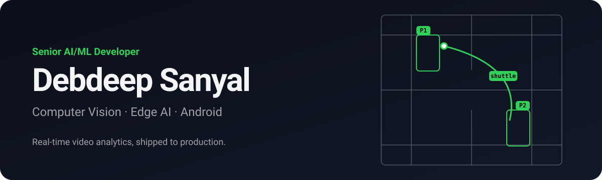

  

  
  
  
  

## 👋 About me
I turn **computer vision research into products that run in real time on live video**, from GPU servers to phones and edge devices.
Senior AI/ML Developer at **Vareli Tecnac** (3.9 years), leading a team of 9+. Currently pursuing **M.Tech in AI & Data Science** at Jadavpur University.

- 🎯 Detection, multi-object tracking, Re-ID, face recognition, pose estimation
- 📱 On-device AI in Android apps live on the Google Play Store
- 🔬 Researching few-shot learning for credit-card fraud on cold-start accounts
- 📍 Kolkata, India

## 🛠 Tech stack

**Languages & frameworks**

  

**AI / ML & computer vision**

  
  
  
  
  

**Android, edge & video**

  
  
  
  
  
  

**Data, cloud & tools**

  

## 🚀 Featured work
| Project | What I built | Stack |
|---|---|---|
| **Play–Pause–Post** · [Play Store](https://play.google.com/store/apps/details?id=com.vtpl.volley&hl=en) | AI sports replay & analytics: shuttle/player tracking, Re-ID, automated line calling, multi-venue streaming | Tracking · Pose · Quantization · S3 |
| **CCTV Vision** | Multi-camera surveillance: face recognition, ANPR, attendance and workforce analytics | RTSP · GStreamer · GPU inference |
| **RetailVision AI** | Queue, occupancy and shelf analytics for retail | Tracking · Re-ID · Pose |
| **V-Commute** · [Play Store](https://play.google.com/store/apps/details?id=com.vcommute.traveltracking&hl=en) | Geofenced attendance with on-device face auth and anti-spoofing | Android · On-device AI |

## 📊 GitHub stats

  
  

## 📂 Public repos
- [**Portfolio**](https://github.com/DevDebsan/Portfolio) – my site: Angular, TypeScript · [live](https://devdebsan.github.io/Portfolio/)
- [**Two-Phase-Simplex**](https://github.com/DevDebsan/Two-Phase-Simplex) – linear programming solver in Python
- [**gdp-dashboard**](https://github.com/DevDebsan/gdp-dashboard) – GDP data dashboard in Python

---

<i>Open to AI/ML and computer vision roles · <a href="mailto:sanyaldebdeep@gmail.com">let's talk</a></i>

